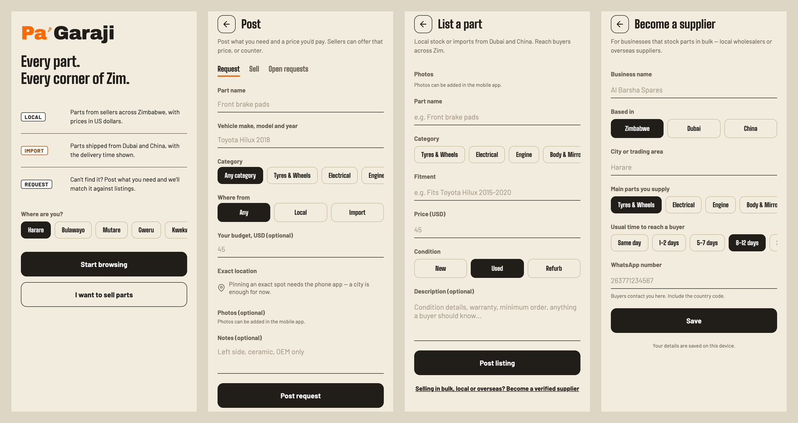

# PaGaraji: spare-parts marketplace for Zimbabwe

A mobile app (iOS and Android, built with Expo) where drivers in Zimbabwe find vehicle spare parts and mechanics and suppliers compete to supply them. Buyers can browse listings, or post a **request** for a part and receive **bids** from sellers, in the style of ride-hailing apps. Not yet in the app stores: it runs in Expo Go, and a waitlist page is at [pagaraji-landing](https://github.com/tadiwachirambamhanda-cyber/pagaraji-landing).



*Screens from the web build running locally. Signed-in screens (live bids, chat, map) need a phone and real accounts, so they are not shown.*

## What it does
- **Listings and requests:** sellers list parts with photos; buyers post what they need, and sellers can place and counter offers with live-updating bids.
- **Real-time chat** between buyer and seller, with a "needs a response" badge for countered offers.
- **Map and live location** to find parts and sellers nearby, and share a location in a chat.
- **Trust:** verified-supplier tags, seller ratings, deal completion, and a manual supplier-verification checklist (`docs/supplier-verification.md`).
- **Helpers:** vehicle fitment matching, price guidance, flags when an open request matches what a seller already lists, dark mode.
- **Deals, Selling and Activity tabs** so both sides can follow every offer.

## Back end
Supabase (Postgres, Auth, Storage, Realtime) with **26 migrations**, row-level security on the tables, and signed URLs for photos. Phone numbers are normalised for Zimbabwe and UAE formats.

## Run it
```bash
npm install
npx expo start
```
Create `.env.local` with `EXPO_PUBLIC_SUPABASE_URL` and `EXPO_PUBLIC_SUPABASE_ANON_KEY` (the anon key is public by design; access is controlled by row-level security). Run the SQL in `supabase/migrations/` in order on your own Supabase project.

## Stack
Expo SDK 57, React Native, expo-router, TypeScript, Supabase, react-native-maps. About 12,700 lines of TypeScript.
